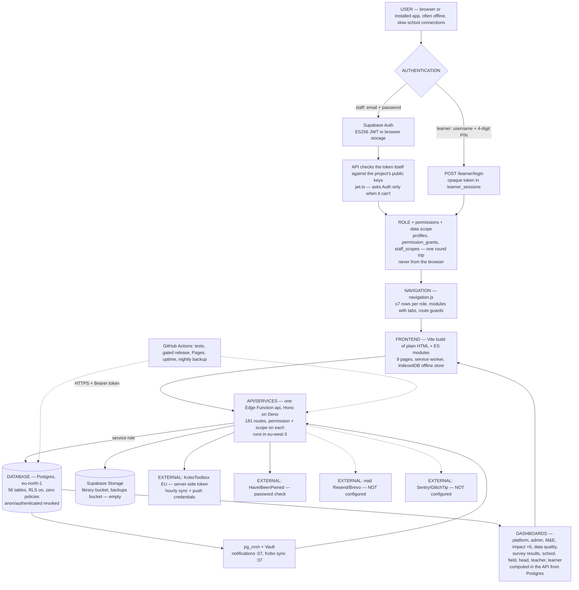

# HPF Learning Portal — audit and improvement backlog

**Second audit: 8 October 2026, evening.** The same 23-point brief as this
morning, re-run after the morning's fixes (section 5). Nothing was changed
to write it. The morning version is in git history (`b1169f1`).

**How it was checked:**
- **Code:** read and measured.
- **Live site and API:** timings and headers.
- **Production database:** read-only queries.
- **Supabase:** the security and performance advisors.
- **Accessibility:** an automated WCAG 2.1 AA check (axe-core 4.10.2) of
  about 70 signed-in screens, covering all 8 roles. The field officer, head,
  teacher, M&E and learner screens were also checked at phone width (375 px).
  The screens ran the real pages against the in-memory test world, so no
  production data was used.

Related: [`NAVIGATION.md`](NAVIGATION.md) (menus), [`RBAC.md`](RBAC.md)
(access model), [`OPERATIONS.md`](OPERATIONS.md) (monitoring, backups,
releases), [`AUTH.md`](AUTH.md), [`../RESTORE.md`](../RESTORE.md).

---

## Summary

The portal is **real end to end**, and there is **no mock or demo data on
any runtime path**:
- Supabase Auth for staff, and PIN sessions for learners stored in Postgres;
- roles, permissions and data scope checked on every API request;
- every screen fed from Postgres through one Edge Function;
- Kobo synced every hour;
- files in Supabase Storage.

Browser storage holds offline copies, the offline queue and preferences,
all by design.

**Since this morning:**
- Kobo data counted on the dashboards went from 38 to **246 of 398**
  submissions, and data quality from 77.9% to 82.9%.
- Signed-in requests skip a 350–400 ms call to Supabase Auth.
- The Platform overview shows operational checks.
- CORS no longer trusts a stranger's site.

**What matters now:**
1. **No backups exist** (P0-1, needs you). The nightly job fails at its
   first step for want of one GitHub secret. The same secret lets releases
   deploy the API.
2. **150 field submissions name two schools the portal doesn't have**
   (P0-2, an admin or M&E decision).
3. **Four owner-only steps:**
   - mail and closed sign-ups (P1-2);
   - error tracking (P1-5);
   - an outside uptime monitor (P1-6) — GitHub runs the 10-minute check only
     every 4–7 hours;
   - a second Super Admin (P1-7).
4. **New: automatic corrections aren't all in the audit log** (P1-8). The
   hourly Kobo run moved 208 submissions from "needs review" to "counted"
   and logged nothing.
5. **New: accessibility.**
   - Primary buttons and status pills fail colour contrast on almost every
     page (3.09:1 and 2.94:1, against 4.5:1 needed).
   - Scrolling tables can't be reached by keyboard.
   - Two controls have no label.
   - All of these come from a few shared styles and helpers (P2-11, P2-12).
6. **Scale and structure** (P2-4, P2-5): a 9,245-line API with 129
   whole-table reads, and a 3,317-line console module.
7. **Adoption** (P2-8): 2 learners, 0 assignments, 0 forms and 0 M&E
   indicators. The dashboards are real but mostly empty.

---

## 1. Architecture map

### Real, local or simulated

| Part | State | Notes |
|---|---|---|
| Staff sign-in | **Real** | Supabase Auth: email + password, temporary passwords, invitation links. Tokens checked in the API against the project's public ES256 key |
| Learner sign-in | **Real** | scrypt PIN hash, `learner_sessions`, lockout after 5 tries |
| Roles, permissions, scope | **Real** | `permissions.ts` plus the database, checked on every route. A failed access read now refuses rather than widening scope |
| Every screen's data | **Real** | `api.js` → Edge Function → Postgres. The browser never touches the database |
| Kobo | **Real** | 3 surveys, 398 submissions: 246 counted, 1 accepted on review, 151 waiting. Synced hourly by pg_cron |
| Files | **Real** | `library` bucket, signed URLs |
| Notifications | **Real** | pg_cron hourly: 24 of 24 runs succeeded in the last day |
| Exports (Excel/CSV/PDF) | **Real** | Built in the browser from live API data |
| Platform health checks | **Real** | 12 checks, including backups, mail, error tracking, sign-ups and Kobo freshness |
| Error reporting | Real code, **off** | No `SENTRY_DSN` |
| Backups | Real code, **failing** | `backup.yml` stops: no `SUPABASE_ACCESS_TOKEN` secret |
| Uptime | **Real, sparse** | Runs, but every 4–7 h, not every 10 min |
| Staging | Ready code, **no project** | The Free plan's 2 projects are both used |
| Mail (invites, password resets) | **Not configured** | No `MAIL_*` secrets, no custom SMTP |
| Airtable | **None** | No code, table or secret |
| Offline copies, queue, drafts | **Local, by design** | IndexedDB plus visit drafts in localStorage, synced to the real API |
| Mock or demo data | **None** | The demo dictionaries were removed this morning. Tests use an in-memory stand-in, never production |
| Fixed lists | **Static, checked** | Grades and visit types live in the pages for offline use; a test fails if they differ from the API's. Library subjects come from the database |

---

## 2. The audit

### 1. Overall architecture
- **Shape:** a multi-page web app with no framework: 9 pages plus a
  workspace template, 42 ES modules. Vite builds it into hashed files; Vercel
  and GitHub Pages serve it.
- **Offline:** a generated service worker and IndexedDB.
- **Backend:** one Supabase Edge Function in front of a locked database.
- **Releases:** CI on every push. Releases go `staging` → tests → production
  → Pages (`release.yml`), all green today.
- **Gap:** the release can't deploy the API or migrations without the
  `SUPABASE_ACCESS_TOKEN` secret. Today they were deployed by hand, so
  production can lag the repository unless someone remembers to deploy.

### 2. Frontend
- **Shared modules:** `nav.js` (menus, tabs, breadcrumb), `api.js`,
  `sync.js` / `offline.js`, `util.js` (skeletons, error and empty states,
  dialogs).
- **Feature modules,** loaded when needed: `admin-ui`, `impact-ui`, `mel-ui`,
  `dq-ui`, `kobo-ui`, `training-ui`, `learners-ui`, `assignments-ui`,
  `reports-ui`, `sync-problems-ui`.
- **JavaScript up front** (minified / gzipped):

  | Page | Up front |
  |---|---|
  | Sign-in | 61 / 21 KB |
  | Console pages (admin, education, M&E, platform) | 47 / 11 KB, the rest on demand |
  | Field | 232 / 69 KB |
  | Head | 276 / 81 KB |
  | Teacher | 279 / 83 KB |

  The field, head and teacher pages include the 100 KB auth library and
  `workspace.js`.
- **Large file:** `console.js`, 3,317 lines (101 KB minified).
- **Inline styles:** 412 `style=""` attributes.

### 3. Backend / API
- **Size:** `index.ts` has 9,245 lines and 181 routes. Rules live in pure
  modules: `lms`, `impact`, `intelligence`, `me`, `data_quality`,
  `kobo_pipeline`, `notifications`, `reports`, `scope`, `permissions`,
  `telemetry`, `jwt`, `mail`, `pwned`.
- **Database access:** the service role only. 129 calls read whole tables
  page by page and aggregate in memory.
- **Location:** the function runs in eu-west-3 (Paris); the database is in
  eu-north-1 (Stockholm).
- **Timing:**
  - a warm `/health` takes 0.74–1.0 s from Kenya, and 1.9 s cold;
  - one query from the function takes 136–198 ms, and 524 ms cold;
  - signed-in requests now skip a 350–400 ms Auth call and one database
    round trip;
  - `Server-Timing` shows the split in the browser's developer tools.
- **Tests:** 370 in 16 files. They cover every route's access rules, school
  and county walls, the domain rules, the token check and CORS. CI keeps the
  output when a test fails.

### 4. Database
- **Tables:** 56 in `public`, plus the 4 Oct RBAC backup schema
  (`backup_20261004_rbac`, 50 tables of personal data). 30 migration files,
  matching production.
- **Live data:**

  | Area | Count |
  |---|---|
  | Places | 24 schools in 4 counties; 9 subjects |
  | Staff | 12 profiles; 13 Auth users (1 without a profile); 1 active Super Admin; 0 waiting for approval; 3 invitations; 3 scope rows; 0 grants |
  | Learning | 2 learners, 1 class; 0 assignments, 0 submissions, 0 forms |
  | M&E | 1 programme, 0 indicators |
  | Programme | 4 trainings, 2 field visits, 3 library items |
  | Kobo | 398 submissions (246 counted) |
  | Data quality | 160 open issues |
  | Logs | 43 audit entries; 175 notification runs; 9 devices reporting sync |

- **Unused:** `assignments_legacy` (empty).
- **Advisors:**
  - security: "RLS on, no policy" (106 tables, informational, by design),
    and the Free-plan leaked-password warning;
  - performance: the backup schema's 50 tables have no primary keys, and
    68 indexes are unused, normal for a database this young and small.

### 5. Authentication
- **Working:**
  - email + password;
  - remember-me;
  - temporary passwords that must be changed;
  - invitation links (copy and send by hand);
  - learner PINs with lockout;
  - the HaveIBeenPwned check on new passwords.
- **Changed today:** staff tokens are verified in the API against the
  project's ES256 public key. Anything it can't verify goes to Supabase Auth.
- **Gaps:**
  - **Password-reset emails fail:** there's no custom SMTP.
  - **Public sign-up is open** (`disable_signup: false`), though an account
    reaches nothing until an admin approves its profile.
  - Google sign-in is off.
  - **New trade-off:** after sign-out, an access token keeps working until
    it expires (Supabase's default is 1 hour), because the API no longer asks
    Auth on every call. Suspension, deactivation and role changes still take
    effect immediately; they're read from the database each time.

### 6. Role-based permissions
- **Model:** 8 roles and a permission per action. Every route checks a
  permission and the data scope, never a role name or anything the browser
  sends. Grants are audited.
- **Super Admin:** has every right. **Only one Super Admin is active**, and
  the Platform overview flags it.

### 7. Navigation
- **Live since 7 Oct** (`NAVIGATION.md`):
  - ≤7 rows per role, modules with tabs and breadcrumbs;
  - one home per function;
  - Super Admin has a system-only menu and Switch workspace;
  - route guards on every page.
- **School pages:** their sections are a proper `nav` with `aria-current`
  since today.
- **Leftover:** the head's own Teachers and Learners pages sit beside the
  Schools module. They're kept because the head *manages* from them.

### 8. Dashboards
- **One per role:**
  - Super Admin: Platform overview;
  - Admin: Administration overview;
  - M&E: overview and results;
  - Education Team: learning;
  - Field Officer: tiles and actions;
  - head, teacher, learner: their own panels.
- **Analytics:** six programme dashboards, the Data Quality Center, survey
  results.
- **State:** all computed from live data. They stay thin until learners,
  assignments and indicators are entered; Kobo is still where most of the
  data is.

### 9. The Platform overview (`platform.html#platform-overview`)
- **Tiles:** staff, sign-ins this week, learners, schools, data quality,
  access exceptions.
- **12 health checks:**
  - Super Admins;
  - field officers placed;
  - heads linked;
  - approvals;
  - Kobo synced in the last 3 h;
  - notifications;
  - data-quality scan;
  - devices;
  - **backup age**;
  - **invitation mail**;
  - **error tracking**;
  - **public sign-ups**.

  The API release and environment are shown beside the checks.
- **Also:** integrations, recent security events, accounts by role.
- **Live, at least 5 checks would fail:** one Super Admin, no backup, no
  mail, error tracking off, sign-ups open. Kobo, notifications and the
  data-quality scan pass.
- **Can't show uptime:** if the API is down, this page can't load either.
  An outside monitor is the only fix (P1-6).

### 10. Data sources
- **Postgres:** everything.
- **Supabase Storage:** library files; backups, once they run.
- **Supabase Auth:** staff accounts.
- **KoboToolbox (EU):** by API token, server-side only.
- **HaveIBeenPwned:** k-anonymity password check.
- **Google Fonts:** loaded without blocking the page.
- **Not connected:** mail, Sentry, Airtable.

### 11. Kobo
- **Pipeline:** raw submission → validation → `kobo_records` (plus issues and
  school aliases) → dashboards and data quality.
- **Who does what:**
  - connection and field mapping: Super Admin;
  - Sync now and re-check: Admin;
  - the hourly sync: pg_cron at :37, with the secret in Vault.
- **Today's fix:** "Aitong primary school" now matches "Aitong Pri". It
  matches when a name's distinctive words are exactly a school's;
  misspellings are only suggested, never linked.

  | Survey | Counted | Waiting |
  |---|---|---|
  | Teach2030 Adoption Barrier Survey | 38 | 1 |
  | SUMMA Endline | 208 | 150 |
  | Classroom Observation | 0 | 1 |

- **The 150 SUMMA submissions:**
  - **Ilkerin primary school** (105) and **Ilmonchin primary school** (44),
    which aren't portal schools;
  - 1 with no school at all.
- **Live push:**
  - credentials were made on 7 Oct, but no submission has ever arrived by
    push (all 398 came by sync);
  - Kobo hasn't received a new submission since 3 Oct, so it may simply have
    had nothing to send;
  - the hourly sync covers it either way.
- **Audit gap (new):**
  - the hourly run writes to the audit log only when submissions are added,
    changed or removed in Kobo, not when a re-check changes a submission's
    result (the 208 today);
  - neither run's audit entry records the per-survey counts;
  - the data-quality side *was* logged: 208 issues auto-resolved, each with
    an event.

### 12. Airtable
**None:** no code, no table, no secret. If it's ever needed, it should be
fed *from* the portal as a reporting copy.

### 13. Supabase integration
- **API side:**
  - Auth (admin calls and the public key);
  - Postgres through the API only;
  - Storage with signed URLs;
  - pg_cron, pg_net and Vault (two hourly jobs, 0 failed calls in 24 h);
  - one Edge Function.
- **Browser side:** only Auth and Storage, through pinned and bundled
  `@supabase/auth-js` and `@supabase/storage-js`.
- **Tools:** the CLI is linked. The claude.ai Supabase connector works.

### 14. Browser storage
- **localStorage:**
  - the Supabase session;
  - `hpf_remember_me`;
  - the learner token;
  - `hpf_device_id`, `hpf_nav_rail`;
  - visit drafts;
  - the last email or username per role;
  - a pending invite and role during sign-up;
  - Kobo "opened" markers.
- **sessionStorage:** the session, when remember-me is off.
- **IndexedDB:** API copies per account, the offline queue, files saved for
  offline, and sync events.
- **None of it is mock data.** The tokens are protected by the strict CSP:
  no inline or third-party scripts. Signing out clears the account's copies.

### 15. Charts and analytics
- **Charts:** hand-rolled bars, comparisons, a donut and trends, with no
  chart library.
- **Accessible:**
  - bars are HTML with text values;
  - the survey donut reads out every answer since today;
  - small numbers (<5) are hidden on the impact dashboards.
- **Gap:** the tables beside the charts scroll sideways but can't be
  reached by keyboard (§22).

### 16. Responsive and mobile
- **Phone width:** at 375 px, no page scrolls sideways. The field officer,
  head, teacher, M&E, learner and sign-in screens were checked today; the
  console pages on 7 Oct.
- **Layout:** the sidebar becomes a drawer; tables scroll inside their own
  frame.
- **Install:** the app installs. The service worker and version are live on
  both hosts (`hpf-4db6958da971`).

### 17. Loading, error and empty states
- **Shared kit:** skeletons, error states with "Try again", empty states,
  friendly messages, the offline banner and the sync chip.
- **Today's check:** no screen was left showing "Loading…" or an error.
- **Minor:** a few first-paint placeholders are still plain text.

### 18. Security and RLS
- **Locked down:**
  - RLS on for all 56 tables, with zero policies; `anon` and
    `authenticated` have no grants;
  - the service-role key exists only inside the function;
  - append-only audit, data-quality, notification and sync event tables;
  - the Kobo token and cron secret never leave the server.
- **Headers:** CSP with script hashes, HSTS for 2 years, `X-Frame-Options:
  DENY`, `nosniff`, a referrer policy and a permissions policy.
- **CORS (fixed today):** our two hosts, our own Vercel previews and
  localhost only.
- **Open points:**
  - public sign-up is open;
  - no backups;
  - the backup schema holds a stale copy of personal data;
  - the sign-out token window (§5);
  - one leftover Auth user without a profile.

### 19. Duplicate functionality
- **Kept on purpose:**
  - the head's Teachers and Learners pages next to the Schools module;
  - Kobo surveys next to the portal's own forms.
- **Lists:** grades and visit types exist in both the pages and the API. A
  test now keeps them equal.
- **Unused, kept:** the `/intelligence` route. The tests use it to check
  the numbers behind the impact dashboards, and it's guarded like `/impact`.
- **Unused, to drop with your OK:** `assignments_legacy`, which is empty.

### 20. Broken or incomplete
- **Not working:**
  - backups;
  - error tracking;
  - password-reset email;
  - invitation email;
  - Google sign-in (off).
- **Weak:** the uptime check runs every 4–7 h instead of every 10 min.
- **Not set up:** staging.
- **Not started:** the M&E framework (0 indicators).
- **Incomplete:**
  - the audit trail of automatic Kobo re-checks (§11);
  - the teacher's CSV learner import: one request per row, no preview, and a
    comma-only parser, so a quoted name like "Wanjiru, Mary" breaks it.
- **Flaky test:** one test failed once in CI and hasn't failed since.

### 21. Performance
- **Sign-in page:** Lighthouse 98 on mobile, 96 on slow 3G (7 Oct).
- **API:**
  - one Auth call and one database round trip fewer per signed-in request;
  - still Paris → Stockholm for every query;
  - dashboards read whole tables, which is fine at today's size but won't be
    at thousands of learners or submissions.
- **Bundles:** the teacher and head pages load about 80 KB gzipped before
  showing anything (§2). The console pages start with 11 KB and fetch the
  rest.

### 22. Accessibility
Checked automatically today across about 70 signed-in screens:

| Finding | Where | WCAG | Count |
|---|---|---|---|
| **Primary buttons:** white on orange `#D97A34` = 3.09:1 (needs 4.5:1) | Almost every page | 1.4.3 contrast | every `.btn-primary` |
| **Status pills:** green "Active" 2.94:1, red 3.6:1, orange 3.87:1; data-quality severity pills | Users, account activity, data quality, many lists | 1.4.3 | up to 16 per screen |
| **Scrolling tables can't be reached by keyboard** (`.lms-table-wrap`) | Platform overview, account activity, permissions, assignments, teachers, learning dashboards, field operations, head's results, teacher's results | 2.1.1 keyboard | about 12 screens |
| **Unlabelled question-type dropdown** in the form builder | Admin and Education Team → Forms | 4.1.2 name (critical) | 1 |
| **Unlabelled CSV file input** | Teacher → My learners | 1.3.1 / 4.1.2 (critical) | 1 |

- **Clean:**
  - the sign-in page (0 violations);
  - every other check: labels, images, landmarks, ARIA, headings and
    lists.
- **Manual testing:** a signed-in screen-reader pass hasn't been done.

### 23. UI consistency
- **Inline styles:** 412 inline `style=""` attributes, so spacing varies.
- **Native dialogs:** the teacher's roster edits a learner through **four
  native `prompt()` boxes in a row**, and resets a PIN the same way. Every
  other edit in the portal uses in-app forms or `confirmDialog`.
- **Charts:** two styles (impact bars, the console donut).
- **Headings:** some module pages have their own `<h2>`, and some don't.

---

## 3. Improvement backlog

Priority = the section: **P0** critical · **P1** high · **P2** important ·
**P3** polish. **"Needs you"** marks items only the owner can do: an
account, a key, a payment, or approval to delete data. IDs are kept from
the first audit; closed items are listed in section 5. **New** marks
items found in this second audit.

### P0 — critical

| ID | Current state | Problem | Recommended solution | Files / components | Tables | Risk |
|---|---|---|---|---|---|---|
| P0-1 | No backups exist. The nightly job runs and stops: *Add the SUPABASE_ACCESS_TOKEN repository secret*. The same missing secret means releases don't deploy the API or migrations | Any accident — a bad update, a deleted project — loses everything. Production can lag the repository | **Needs you:** add the secret, run *Nightly database backup* once, record the restore check in `RESTORE.md`. Consider Pro (daily backups, PITR) | `.github/workflows/backup.yml`, `release.yml`, `RESTORE.md` | all | Total data loss until done |
| P0-2 | 246 of 398 Kobo submissions counted. 150 SUMMA Endline submissions name *Ilkerin* (105) or *Ilmonchin* (44), which aren't portal schools; 1 names none | 42% of the endline results are missing from the dashboards and M&E | **Needs an admin or M&E decision:** add the two schools (Schools), or, if Ilmonchin is Olemoncho (NRK-010), add it as an alias on the Kobo review page. The hourly sync re-checks by itself. Then review the last one by hand | Schools module, `kobo-ui.js` (aliases, review) | `schools`, `kobo_school_aliases`, `kobo_records`, `dq_issues` | A wrong alias puts results on the wrong school; aliases are audited and reversible |

### P1 — high

| ID | Current state | Problem | Recommended solution | Files / components | Tables | Risk |
|---|---|---|---|---|---|---|
| P1-2 | No custom SMTP; `disable_signup: false` | Password-reset emails fail; anyone can create a (powerless) Auth user | **Needs you:** `node --env-file=.env scripts/configure-auth.mjs --apply` with a mail-provider key (or `--signups-only` first) | `scripts/configure-auth.mjs`, `docs/AUTH.md` | Auth config | Locked-out users; junk accounts |
| P1-5 | Error tracking built, off | Production errors are invisible | **Needs you:** a Sentry or GlitchTip project; set the `SENTRY_DSN` function secret | — | — | None |
| P1-6 | Uptime runs, but GitHub fires the 10-minute schedule every 4–7 h | An outage can go unnoticed for hours. The Platform overview can't report it, because it needs the API | **Needs you:** a free outside monitor (UptimeRobot, Better Stack, …) on `/functions/v1/api/health`, alerting by email/SMS; keep GitHub's as a backup | `.github/workflows/uptime.yml`, `docs/OPERATIONS.md` | — | None |
| P1-7 | One active Super Admin | If that account is lost or locked, nobody can run the platform | **Needs you:** invite a second trusted Super Admin | — | `profiles` | Lock-out |
| P1-8 **New** | The hourly Kobo run writes to the audit log only when Kobo adds, changes or removes submissions. Today it moved 208 from "needs review" to "counted" and logged nothing. Neither run records per-survey counts | Your rule: every correction must be auditable | Count re-check changes (`updated`) as "moved"; store each survey's added / changed / removed / updated / counted / waiting in the `kobo.synced` entry, for both Sync now and the hourly run; a test for each | `supabase/functions/api/index.ts` (`runKoboSync`, `/kobo/sync`, `/kobo/sync/run`), `authz_test.ts` | `audit_log` | None — append-only |

### P2 — important

| ID | Current state | Problem | Recommended solution | Files / components | Tables | Risk |
|---|---|---|---|---|---|---|
| P2-4 | 129 whole-table reads; dashboards aggregate in memory | Slower and slower as data grows; timeouts at thousands of rows | Move dashboard aggregates to SQL (views or RPC), paginate lists, check indexes; one dashboard at a time, with tests comparing old and new numbers | `index.ts`, `impact.ts`, `intelligence.ts`, `data_quality.ts` | `learners`, `assignment_submissions`, `kobo_records`, `library_interactions`, … | Medium — numbers must match |
| P2-5 | `index.ts` 9,245 lines / 181 routes; `console.js` 3,317 lines | Hard to change safely; every cold start loads everything | Split by domain (users, schools, learning, kobo, mel, dq, sync, reports) with no behaviour change, in steps; move the console's remaining pages into lazy modules | `supabase/functions/api/*`, `console.js` | — | Medium — the route-coverage test catches misses |
| P2-6 | No staging project | Changes reach production after tests but without a rehearsal | **Needs you:** Pro, a freed project slot, or another account; then `scripts/bootstrap-staging.mjs` | `bootstrap-staging.mjs`, `environments.json` | all (structure only) | Low |
| P2-7 | Invitation emails can't send | Admins copy and send links by hand | Comes with P1-2 (`configure-auth.mjs` sets `MAIL_*`) | — | — | Low |
| P2-8 *(revised)* | Teachers can already add learners from a CSV (*My learners*). It sends one request per row, shows no preview, and splits on commas only. Heads and admins can't import for a school; no staff import. Programme data is nearly empty | Slow and fragile on school connections; the people who onboard schools can't use it; the dashboards stay empty | Improve the existing importer, not a second one: a real CSV parser; a preview with problems marked; one server-side batch route that is idempotent (re-running adds nothing twice) and writes one audit entry; then offer the same importer to heads and admins for a whole school. Plus an onboarding checklist on the Admin dashboard, and M&E's first indicators | `teacher.js`, `learners-ui.js`, `index.ts` (batch route), `admin-ui.js` | `learners`, `learner_enrollments`, `audit_log`, `me_*` | Medium — duplicates and PINs must be handled |
| P2-10 | `assignments_legacy` (empty) and `backup_20261004_rbac` (50 tables, 4 Oct personal data) still exist | A stale copy of personal data; advisor noise | **Needs you:** OK to drop both, after P0-1 (a backup must exist first) | migration | `assignments_legacy`, `backup_20261004_rbac.*` | Data deletion — only with your OK |
| P2-11 **New** | Primary buttons 3.09:1; status pills 2.94–3.87:1 (WCAG AA needs 4.5:1) | Hard to read in sunlight and for low vision; fails WCAG on almost every page | Darken the shared tokens: the button background (or bold large text), and the pill text colours (`--success`, `--danger`, `--accent-fg`); check light and dark themes; re-run axe | `base.css`, `app.css` | — | Low — a visible colour change, so check the brand look |
| P2-12 **New** | Scrolling tables can't be reached by keyboard; the form builder's question-type dropdown and the teacher's CSV file input have no label | Keyboard and screen-reader users can't read wide tables or use two controls | Make `.lms-table-wrap` a labelled, focusable region in the shared table helper; label the two controls; add an axe check to the browser-check routine | the table wrappers in `admin-ui`, `assignments-ui`, `console`, `dq-ui`, `impact-ui`, `kobo-ui`, `mel-ui`, `sync-ui`, `sync-problems-ui` (better: one helper in `util.js`); `console.js` form builder; `teacher.html` | — | None |
| P2-13 **New** | 160 open data-quality issues: 152 "missing school" (the Kobo ones), plus 8 others — 1 duplicate staff, 1 staff without a school, 2 invalid grades, 2 learners without a class, 2 Kobo submissions missing required answers | The score (82.9%) and some lists carry known errors | **Needs an admin:** work through them in the Data Quality Center; most are one edit each. The rest follow P0-2 | Data Quality Center | `dq_issues`, `profiles`, `learners`, `kobo_records` | Low; every change is audited |

### P3 — polish

| ID | Current state | Problem | Recommended solution | Files / components | Tables | Risk |
|---|---|---|---|---|---|---|
| P3-1 | 412 inline `style=""` attributes | Spacing and sizes vary; harder theming | A few utility and component classes, page by page | `*.html`, `*.js`, `app.css` | — | Low |
| P3-6 | One Auth user without a profile | Clutter | Leave, or **with your OK** remove it in the dashboard | — | `auth.users` | None |
| P3-7 | Google sign-in off | Optional convenience | **Needs you:** three dashboard steps (README → "Turning on Google sign-in") | — | — | None |
| P3-8 | The head's own Teachers and Learners pages beside the Schools module | Two looks for the same data | Reuse the Schools module's read-only tabs inside the head's pages; keep their management tools | `leader.js`, `admin-ui.js` | — | Low |
| P3-9 | Teacher and head pages load ~80 KB gzipped up front (including the 100 KB auth library); `console.js` 101 KB | Slower first open on weak connections | Load the auth library and later sections after first paint, as the console pages do; comes naturally with P2-5 | `teacher.js`, `leader.js`, `field.js`, `vite.config.js` | — | Low — the offline start-up must keep working |
| P3-10 | Leaked-password advisor warning | Advisor noise | Covered by the portal's own check; switch Supabase's on with Pro | `configure-auth.mjs` | — | None |
| P3-11 **New** | The teacher's roster edits a learner through four native `prompt()` boxes, and resets PINs the same way | Clumsy on phones, can't be styled or labelled, unlike every other edit | An inline edit form (like the library's) and the in-app dialog for PINs | `teacher.js` | `learners` (unchanged) | Low |
| P3-12 **New** | Since tokens are checked in the API, a signed-out token works until it expires (default 1 hour) | A token copied before sign-out could still be used for up to an hour; suspensions are unaffected | Shorten the access-token lifetime to 15–30 min (refresh keeps people signed in); `configure-auth.mjs` can set it. Or ask Auth on the few most sensitive routes | `configure-auth.mjs`, `jwt.ts` | Auth config | Low — more refreshes on bad connections |
| P3-13 **New** | Kobo push credentials made on 7 Oct; nothing has ever arrived by push | Unclear whether push is set up in Kobo | **Needs you:** add the REST Service in Kobo with the portal's credentials, or remove them; the hourly sync covers it either way | Kobo page (Super Admin) | `kobo_config` | None |
| P3-14 **New** | The function runs in Paris, the database in Stockholm | Every query crosses Europe (measured 136–198 ms per query from the function) | Ask Supabase support how to pin the function to eu-north-1 (the `x-region` header didn't move it) | — | — | None |

---

## 4. Recommended order

1. **Safety first — owner steps, about an hour in all:**
   - P0-1 the GitHub secret, then one backup run (also unblocks API
     releases);
   - P1-2 run `configure-auth.mjs` (mail, closed sign-ups);
   - P1-5 the Sentry DSN;
   - P1-6 an outside uptime monitor;
   - P1-7 a second Super Admin.
2. **Data decisions — an admin or M&E, under an hour:**
   - P0-2 Ilkerin and Ilmonchin (adds up to 149 submissions);
   - P2-13 the 8 other data-quality issues;
   - P3-13 Kobo push, while in Kobo.
3. **Small fixes — one release, mine to do on your word:**
   - P1-8 audit the Kobo re-checks;
   - P2-11 contrast;
   - P2-12 keyboard and labels;
   - P3-11 the roster's edit form.
4. **Adoption:** P2-8 the improved importer for teachers, heads and admins;
   the onboarding checklist; M&E's first indicators. The dashboards only
   show what's entered.
5. **Room to grow:**
   - P2-4 SQL aggregates, one dashboard at a time;
   - then P2-5 split the API and console, behind the test suite, with P3-9
     alongside.
6. **Environment:**
   - P2-6 staging, once the plan is decided;
   - P2-10 the clean-up, after a backup exists.
7. **Polish:** P3-1, P3-8, P3-12, P3-14, P3-6, P3-7, P3-10, in any order.

Each step goes out the same way: one change at a time, tested, released
through `staging`, deployed, and checked in the browser for the affected
roles, now including an axe accessibility pass.

---

## 5. Progress

### 8 October

Released through `staging`, with the API deployed by hand (the release
can't deploy it until the `SUPABASE_ACCESS_TOKEN` secret exists). The test
suite grew from 359 to 370 tests.

| ID | Status | What changed |
|---|---|---|
| P0-1 | **Needs you** | The nightly backup ran on schedule and stopped at its first step: *Add the SUPABASE_ACCESS_TOKEN repository secret*. The Platform overview now shows when the last backup was made. |
| P0-2 | **Mostly done** | The school question in *Learner Assessment Tool – SUMMA Endline* gives labels like "Aitong primary school". The matcher now links a name whose distinctive words are exactly a school's ("Aitong primary school" = "Aitong Pri"); misspellings are still only suggested. After the first hourly sync: **208 of 358 counted** (was 0). **Needs an admin or M&E decision:** the other 150 are *Ilkerin primary school* (105) and *Ilmonchin primary school* (44), which aren't portal schools — add them, or alias Ilmonchin to Olemoncho (NRK-010) if they're the same school — plus 1 with no school. |
| P1-1 | Done | `configure-auth.mjs` reads the URL and key from `environments.json` again; `--check` works. |
| P1-2 | **Needs you** | Run `node --env-file=.env scripts/configure-auth.mjs --apply` with a mail-provider key (or `--signups-only`). The Platform overview shows whether sign-ups are closed and mail is set up. |
| P1-3 | Done | Staff tokens are checked in the function against the project's public ES256 keys (`jwt.ts`). Anything it can't check goes to Supabase Auth as before. The profile, grants and scope rows are read in one round trip. Measured live: asking Auth costs 350–400 ms per request, and a genuine token now skips it; one database round trip from the function is 150–600 ms, and one fewer is needed. The `Server-Timing` header shows `auth;desc="local"` and the times in the browser's developer tools. A failed grants/scope read now refuses with 503 instead of counting as "nothing assigned", which gave admin, M&E and Education Team every school. **Not done:** (b) a per-isolate actor cache — it would delay a suspension by its lifetime, and the parallel reads already removed that round trip; (d) the region pin. |
| P1-4 | Done | pg_cron runs `POST /kobo/sync/run` at 37 past every hour (Vault secret, like the notifications job). It's in the audit log only when something arrived, changed or failed. |
| P1-5 | **Needs you** | Set the `SENTRY_DSN` function secret. |
| P1-6 | Done | Uptime runs on its schedule now (6 runs on 7–8 Oct, all passing). An outside monitor on `/health` is still worth adding. |
| P1-7 | **Needs you** | Invite a second Super Admin. |
| P2-1 | Done | The library's subject pickers (upload and edit) use `GET /subjects`; an item keeps its own subject when edited. |
| P2-2 | Done, differently | The pages keep their copy of the grades and visit types, because a field officer's visit form must work offline. `lists_test.ts` fails the build if they differ from the API's. Content types exist only in the pages. |
| P2-3 | Done | New checks: last backup, invitation mail, error tracking, public sign-ups, and Kobo synced in the last three hours. The API release and environment are shown beside them. |
| P2-9 | Done | CI keeps the API test output and a JUnit report when a test fails, and lists the failing tests in the run summary. |
| P2-10 | Partly | The `/intelligence` route stays: the tests use it to check the numbers the impact dashboards are built on, and it's guarded and scoped like `/impact`. **Needs you:** OK to drop `assignments_legacy` and the `backup_20261004_rbac` schema, once a backup exists. |
| P3-2 | Done | School-page sections are a `nav` with `aria-current`. |
| P3-3 | Done | The survey donut's label reads out each answer, its count and its share. |
| P3-4 | Done | The demo dictionaries are gone from `data.js`. |
| P3-5 | Done | CORS allows the production Vercel host, this team's `-hpf1` previews, GitHub Pages and localhost. It used to allow any `learning-portal*.vercel.app`, including `learning-portal.vercel.app`, which is someone else's site. |

Still open: P2-4 SQL aggregates, P2-5 splitting the monoliths, P2-6
staging, P2-7 invite mail (with P1-2), P2-8 bulk import, P3-1 inline
styles, P3-6–P3-10.

### 8 October, evening — second audit

The brief was re-run against the live portal (sections 1–4 above). New
items: P1-8 (Kobo re-checks not audited), P2-11 (contrast), P2-12
(keyboard access and labels), P2-13 (8 data-quality issues for an admin),
P3-11 (the roster's native prompts), P3-12 (sign-out token window), P3-13
(Kobo push), P3-14 (region). Revised: P1-6 (uptime runs, but sparsely),
P2-8 (a teacher CSV import already exists; improve and extend it rather
than build a second one). No code was changed for the audit.

### 8 October, night — Platform overview redesign

Presentation only: the same API replies, no backend, database or route
changes, and no new metrics.

- **Layout:**
  - a status line ("5 checks need attention · 7 passing") with the API
    release and a Refresh button;
  - six key figures with icons, comparisons and small charts;
  - activity beside what needs attention;
  - recent activity, then integrations and accounts by role.
- **Data used:**
  - `/platform/overview` first;
  - then, each filling its own space as it arrives: the data-quality score
    history (`/data-quality/summary`), changes per day and recent activity
    (`/audit`), sign-in recency (`/security/activity`), and Kobo counted
    vs received (`/kobo/forms`).
  - A figure that can't be read says so, with Try again.
- **Fixed on the way:**
  - recent activity showed raw codes (`account.approved`);
  - 43 of the 70 audited actions had no wording on the Audit page either,
    and now all have.
- **Responsive:** three key figures per row on laptops, six where there's
  room, two on phones (container queries, with a screen-width fallback).
  "Needs attention" moves above the charts on narrow screens.
- **Checked:**
  - at 390, 820, 1180, 1440 and 1920 px, in light and dark, with no
    sideways scroll;
  - axe-core: no WCAG 2.1 AA violations on the page;
  - its status colours use darker shades than the shared pills (P2-11
    still applies elsewhere).

### 12 October — dashboards that stay current

Presentation and behaviour only, in the pages (`live.js`): no backend,
database, route or integration changes, and no new data.

- **A freshness line with a Refresh control** on every dashboard. What it
  says is what's true:

  | It says | When |
  |---|---|
  | **Live · updated just now** | The dashboard refreshes by itself, and is doing so: the page is open and in view, the device is online, and the last read worked |
  | **Updated 5 minutes ago** | Read once; Refresh reads it again |
  | **Refreshing…** | Being read |
  | **Couldn't refresh · updated 6 minutes ago** | The last read failed; what's shown is older. It tries again when the connection or the tab comes back |
  | **Offline · updated…** | No connection |
  | **Saved copy · 2 hours ago** | The copy kept on this device, not the latest from the server |

- **Which dashboards refresh by themselves:**

  | Dashboard | Refreshes |
  |---|---|
  | Survey results | Every 2 minutes (as before, but now only while its page is open) |
  | Platform overview, Administration overview, Executive overview and the five programme dashboards, M&E dashboard, Sync monitor | Every 5 minutes while open, the cadence the menu badges and notifications already use; and on coming back to one that has aged |
  | Data Quality Center | Only on Refresh — reading it can start a scan |
  | Head, teacher, learner and field officer home pages | Not on a timer (school connections). They read again on coming back after 5 minutes, and at once when a connection returns to a saved copy |

- **Updates in place.** A refresh changes only what's different: no
  skeletons, no jump, open sections and scroll position kept. A figure that
  changed, or a new row in a list, is marked for about two seconds (a soft
  highlight; a static underline with reduced motion). Changing filters draws
  the page afresh, with nothing marked.
- **Honest about saved copies.** `api.js` now records whether a read came
  from the server or from the copy kept on the device, and when that copy
  was saved. Role pages used to show a saved copy with nothing to say so.
- **States:**
  - a page-shaped skeleton on the Platform overview's first load;
  - "No recent data" where the activity chart would be empty;
  - a failed refresh never replaces good data with an error.
- **Fixed on the way:** picking another survey while one was loading left
  the page on the old one until the next refresh.
- **Cost:** about 2.5 KB more JavaScript (gzipped) on the role pages; one
  extra read per open dashboard every 5 minutes.
- **Checked:**
  - all eight roles;
  - forced failures, offline and reconnect;
  - a clock moved forward to exercise the schedule: it refreshed the open
    dashboard, and not one that wasn't on screen;
  - axe-core: no violations in any state, light or dark.

### 12 October — visual upgrade of the dashboards

Styles only (`base.css`, `app.css`), plus icons on the executive tiles.
No data, link, button or behaviour changed.

- **Surfaces:**
  - cards go from 20 px to 12 px corners (10 px for tiles and chart cards)
    with a much lighter shadow;
  - a card inside a card has no shadow of its own.
- **Type:**
  - the display face (Baloo 2) stays on the brand, the page title and the
    sign-in page;
  - section headings and figures use the text face (Work Sans);
  - descriptions (`.hint`) had no style at all and rendered at body size;
    they're now smaller and softer.
- **Colour for meaning:** each status has a fill, a tint and a darker text
  colour that passes 4.5:1. **This closes P2-11:** axe-core finds no
  contrast failures on the pages that had them (users, account activity,
  data quality, schools, Kobo, reports, profile).
  - Pills: "Active" was 2.94:1.
  - Solid buttons: white on orange was 3.09:1; they use a deeper orange and
    10 px corners.
  - Error text now uses the darker red.
- **Charts:**
  - bars are one colour per measure (they cycled six), thinner, with
    labels shown in full;
  - target-met / close / not-met and the donut keep their colours;
  - chart cards fill their row instead of leaving holes;
  - a month with nothing is a tick on the baseline.
- **Messages:** "Needs attention" rows are a quiet surface with the colour
  on the edge and the title, not solid orange and blue blocks. Errors keep
  their tint.
- **Layout:**
  - key figures sit six to a row inside a section, and two to a row on
    phones (they stacked one by one);
  - the filter bar is more compact;
  - a lone dropdown no longer spans the page;
  - table headers are lighter.
- **Icons:** the executive tiles and area cards carry the same icons as the
  menu. Two Platform overview cards that showed a generic icon now show
  their own.
- **Checked:**
  - 18 dashboards before and after, at laptop and phone width, in light
    and dark;
  - the sign-in page, a form-heavy page, the content library and a
    teacher's roster;
  - no sideways scroll anywhere.
- **Still open from the audit:** P2-12, the scrolling tables that can't be
  reached by keyboard.

### 13 October — information hierarchy of the dashboards

Every dashboard component was classed as primary, secondary or detail and
the pages re-ordered to match. The classification, page by page, is in
`docs/DASHBOARD-HIERARCHY.md`. Layout and wording only: the API, the
database, sign-in, routes and every figure, link and button are as they
were.

- **Executive overview:**
  - one row of six figures (there were ten tiles in two rows);
  - "Needs attention" straight under them (it was last, a screen and a
    half down);
  - the four demoted figures sit once, in their programme-area card;
  - the areas sit three to a row under their own heading.
- **Needs attention (executive overview and school head):**
  - one line per kind of problem, with how many and which ones, instead of
    one line per school, form or check (up to 17 lines became at most 4);
  - the pressing ones first, a count beside the heading, and a link to
    where each is dealt with;
  - "KoboToolbox not connected" shows only once the settings have been
    read; a failed read of the statistics says so instead of "Loading…".
- **Programme dashboards (Reach, Learning, Teacher development, Field
  operations, Digital resources):**
  - figures, then the M&E indicators tagged for the page, then the main
    charts;
  - long tables and narrower breakdowns are under "More detail", which
    says what's inside and stays open once opened;
  - three summary cards that repeated a tile are gone; what only they
    showed is on the tile or the neighbouring chart;
  - each page's paragraph of explanation is under "About this page".
- **Platform overview:** the figures and "Needs attention" side by side, so
  every failing check is on the first screen; Integrations and Accounts by
  role are closed sections with a one-line status.
- **Administration overview:** the six figures in one row; a count on
  "Needs attention".
- **School head:** learning figures join the top row; "Attention required"
  is second instead of last; the reporting status sits beside the forms it
  describes.
- **Teacher:** resources are one panel instead of three; the home page
  lists six learners, with the rest a search away; no search box over an
  empty marking list.
- **Learner:** "Assignments to do" comes before progress.
- **Page top:** the sync status stays beside the greeting instead of
  dropping under a long line.
- **Checked:**
  - first screens and full pages before and after, laptop and phone, light
    and dark;
  - most pages are a tenth to a third shorter (Field operations 2,112 px
    to 1,365; Learning 1,758 to 1,200; Platform overview 1,961 to 1,463);
  - refresh-in-place still updates only what changed, with "More detail"
    open or closed;
  - axe-core: no WCAG 2.1 AA violations on 15 page states, including dark
    mode, phone width and every closed section opened.

### 14 October — the charts

Every chart now comes from one module, `charts.js`, so the same kind of
question gets the same kind of picture. `docs/CHARTS.md` lists which
picture is used for what, and what each chart was and is. Presentation
only: the same figures from the same API; nothing was invented.

- **Change over time is a line:** visits, Kobo submissions and resource
  openings by month; learner growth, average mark, visits and library use
  by term; platform changes per day; an indicator against its target. Two
  gridlines, round numbers on the axis, only the latest and the highest
  point labelled.
- **Comparing groups is bars:** one colour, largest first, the name and
  value above a full-width bar (the name used to be squeezed beside it),
  whole percentages, and each row's share of the total where the rows add
  up to one.
- **Progress to a target fills towards one line:** on the M&E pages every
  row's target sits in the same place, so rows in different units can be
  read down the page; value, target and "Met / Close / Not met" are in
  words, not colour alone.
- **Shares:** a donut only for two to four parts of one whole (a survey
  question with five or six answers is now bars); the achievement bands
  and "improved / steady / declined" are one split bar with a key.
- **Tables** keep the detail; their percentage columns carry a thin bar,
  and band codes show their full name.
- **Tooltips** on every mark — by hover, tap, or the arrow keys on a line
  chart — repeating what is printed, never the only place a value is.
- **Descriptions:** every chart card says in one line what it shows.
- **Colour:** the four-part sequence, the band colours and the one-hue
  scale were checked for colour-blind separation and contrast in both
  themes; orange and green are no longer neighbours.
- **Filters:** one look for the filter bar and the filters inside pages; a
  filter that is set looks set; "Clear filters" is idle until needed.
- **Checked:** 16 chart pages before and after with a year of test
  history, laptop and phone, light and dark; tooltips by mouse and
  keyboard; refresh-in-place; axe-core clean on 12 page states.

### 14 October — the menus

How the menus read and work, not what is in them: every page, function and
permission is as it was. `docs/NAVIGATION.md` §15 has the details.

- **The sidebar lists each area's pages.** An area with several pages opens
  in place (the one you're in is open; ones you open stay open). The tab
  strip above pages is gone — it overflowed (nine tabs under Dashboards &
  reports, cut off on a laptop, a hidden sideways strip on a phone) and
  repeated what the sidebar now shows.
- **Marks:** the page you're on has the orange edge; its area is lit. Counts
  sit on the area's row while it's closed, on the page once it's open.
- **One name per page in every workspace**, plain words (Device sync, not
  Sync monitor / Devices / Stuck devices; Data quality, not Validation), and
  no page named like its own area.
- **Regrouped where things sat apart from their kind:** M&E's assignments,
  results and training register under Teaching & learning (they were under
  Schools); Kobo review with the other survey pages; Admin's forms and Kobo
  under Surveys & forms, visits under Schools, device sync under Data
  quality; Education's dashboards under Dashboards & reports. Still at most
  seven areas per role.
- **Folded menu:** on the icon rail an area's pages appear beside it on hover
  or keyboard focus.
- **Phone:** a close button in the drawer, finger-sized rows, the keyboard
  starts on the page you're on, the closed drawer is out of the keyboard's
  way, and the breadcrumb drops the workspace name the pill already shows.
- **Also:** the menu now runs the full height of the window on short pages
  (it stopped halfway); P2-12's two unlabelled controls (the form builder's
  answer type, the teacher's CSV upload) have labels, and the form card's
  delete button meets contrast. The keyboard part of P2-12 (scrolling
  tables) is still open.
- **Checked:** every role's menu at laptop and phone width, the drawer open,
  the icon rail, dark mode; opening and closing areas, a page kept for old
  links, keyboard and Escape; navigation tests (6) pass; axe-core clean on
  nine states (every role; drawer, rail and dark mode among them).

### 14 October — the Platform overview as a command centre

The Super Admin's start page is now one dashboard, not a set of sections:
the platform's state, a summary of each part with a link to its page, and
what is waiting on someone. Only figures the page already read; no new API
call.

- **Platform status:** one line — health checks needing attention, how many
  pass, queues waiting for someone, the API's release — with "Review N
  actions".
- **User activity, Data activity, System activity:** a card each. Every
  figure has a link to where the detail lives ("View users →", "View Kobo
  data →", "View data quality →", "Device sync →" …). System activity gives
  each part a light: working, needs attention, not in use.
- **Important actions:** the failing health checks and, new here, the queues
  with something in them — Kobo submissions to review, high-severity data
  issues, learners locked out — each with Open. Passing checks fold away.
- **Recent changes:** changes per day over the fortnight and the latest five,
  with links to the audit log and security events.
- **Not repeated here any more:** the accounts-by-role table and the list of
  field officers without schools (both on Users & roles; the officers are
  named in their health check), and the long integrations list (now one
  line per part).
- **Checked:** laptop, tablet, phone and dark mode; refresh in place with
  changed data; the "Review" jump; every link opens an existing page;
  axe-core clean in light, dark and phone views.

### 14 October — the key figures

Every key-figure card in the portal is now drawn by one function
(`kpi.js`), so they read the same everywhere: icon and title, the value,
a change where the data supports one, and a line of context (CHARTS.md,
"Key figures"). Only figures the pages already read; no API, permission or
route changed.

- **Changes, only where real:** completion and the average mark compare
  the latest term with the one before (the API already gives both per
  term); the data quality score compares with the scan before. Counts get
  no arrow — the term or month under way is shown beside the one before,
  in words. Nothing is estimated.
- **Context added from data already there:** learners who joined this
  term; "since Monday · N last week" for the teacher's hand-ins (shown only
  when the list wasn't cut short); the share of enrolled learners who
  signed in this week; when a school was last visited.
- **Clickable cards look clickable:** an arrow by the title, and a lift,
  darker border and underlined title on hover or focus. Cards that open
  nothing have no arrow. New links: the programme dashboards' cards open
  their pages (only those the person may open); the school head's,
  teacher's and learner's cards open the matching page; a school's
  overview cards open its tabs.
- **Fewer cards saying the same thing:** the six Data Quality Center
  counts became Open issues and Closed issues; Kobo submissions and Kobo
  needing review, Active users and Learner reach, Active teachers and
  Setting work, the learner's To do and Overdue — one card each. The school
  head's name moved from a big figure to the context of Teachers.
- **Warning colour only on figures that are waiting on someone** (work to
  mark, forms to finish, open issues, locked out); elsewhere the words say
  it.
- **Fixed on the way:** a school's profile was wider than the screen (its
  two short tables had a 36rem minimum); they now fit their column.
- **Checked:** every page with key figures, laptop and phone, light and
  dark; hover and focus; refresh in place keeps the same cards; axe-core
  clean.

### 14 October — how pages work, task by task

Every page now follows the same steps: open it, see what it is for, see what
matters, act, and see that it worked (NAVIGATION.md §16). No page, function,
permission, route or API changed.

- **Page headings:** the heading at the top was "Habari, name" on every
  page, so the page's own name was only in the small breadcrumb, and inside
  the page under a different name ("Accounts" in the menu, "Staff accounts"
  on the page). Now the start page greets; every other page is headed with
  its name and one line on what it is for. Repeated headings and hints are
  gone.
- **Main actions:** Add learner and New assignment were small text links;
  they are now the page's main button. Start visit is an ordinary button in
  the list of schools. Adding learners from a spreadsheet folds away, so the
  roster shows straight away.
- **Sensitive actions:** on Staff accounts the actions that affect sign-in
  are in the warning colour on their own line (Suspend was plain blue);
  Delete form and Archive learner are red. The confirm dialog starts on
  Cancel for anything hard to undo, keeps the keyboard inside it and returns
  the focus afterwards. "Run now" on Notifications and applying a
  data-quality correction now ask first.
- **Forms, not prompts:** editing a learner was four browser prompts in a
  row (gender typed as free text); setting a PIN was another. Both are
  forms, checked as the server checks them, and the new PIN is shown once.
- **Messages:** ten successes showed in the neutral colour with no
  detail ("Learner updated"); they now say what was done, in green.
  Failures say what failed. Problems stay 10 seconds; every message has a
  close button. Searches that find nothing say what was searched for.
- **Staff accounts table:** the email is under the name, so each row's
  actions fit on two lines at laptop width (they stacked five deep), and at
  1280 px no action is cut off any more.
- **Contrast:** the red confirm button and the green and red messages were
  below 4.5:1 in light mode; they now use the deeper shade of each colour.
- **Checked:** every page in every workspace for its heading and purpose;
  the new flows by hand (edit a learner with a wrong username then a right
  one, a new PIN, suspend with the keyboard, run notifications); axe-core
  clean with the dialogs and panels open, in light, dark and phone views.
  Applying a data-quality correction asks first, but the test data has no
  issue with a correction to apply, so that dialog was checked in the code,
  not by clicking.

### 15 October — interactive dashboards

The dashboards lead to their detail, and the filters go along
(NAVIGATION.md §17, CHARTS.md "Picking a bar or a point"). Existing pages
and data only; no page added, no API, permission or route changed.

- **Filters:** kept through a reload for the tab; shown only where they
  apply; each can be taken off with its ×; Period gains the last 30 days
  and whole school years; a date range can't run backwards.
- **Charts:** a county's bar narrows the dashboard to it; a month or term
  on a line sets the dates (by mouse, touch or keyboard); a visit type, a
  subject or a resource opens its detail page, filtered. Charts say so in
  their description.
- **Detail pages:** Field visits, All teachers, All schools and Assignments
  follow the dashboard's county, school and period; Field visits gains a
  Visit type filter and Assignments a Subject filter (both from data
  already loaded); Find a learner lists the picked school's learners;
  Results says when a county or date range can't apply to it.
- **Clickable figures:** key figures, attention items and the overviews'
  links open their page with the filter set ("Field visits this term"
  opens this term's visits; "high-severity data issues" opens those).
- **Breadcrumbs:** a page opened from a dashboard shows the way back to it.
- **Tables:** sortable by any column (more than three rows), keeping the
  sort when drawn again.
- **Searches:** a count says how many of the whole list match ("3 of 42
  visits"), and an empty result says which filter to take off.
- **Checked:** county → Visit type → Field visits with the county, term and
  type applied (3 of 42), back by the breadcrumb with the filters intact;
  the subject bar's count matches the Assignments page (13 and 13 of 38);
  "Field visits this term" 9 and 9 of 42; a school picked → Find a learner
  lists its learners; Enter on a chart point; reload keeps the filters;
  axe-core clean on the dashboards and detail pages, light, dark and phone.

### 15 October — loading, empty, error and success states

The four states read and look the same everywhere (NAVIGATION.md §18).

- **Loading:** about 40 placeholders that said only "Loading…" are now
  skeletons in the shape of what's coming — tables, key figures, chart
  cards, whole dashboards, lists; another 50 lists that sat blank while
  loading have one too. Dashboards and tables that loaded as generic
  list rows now load as themselves. Checked: no page keeps a skeleton once
  loaded.
- **Fixed:** the Data Quality Center showed a stray `${'` while loading (a
  template fragment in plain HTML); staff accounts said "No staff accounts
  yet" and the teacher's dashboard "0 to mark — nothing waiting" before
  their data had arrived; the live dashboards didn't recognise their own
  error box (`.error-state` vs `.state-error`).
- **Empty:** filters that hide everything say "Nothing matches your
  current filters." everywhere; dashboard charts say what and where ("No
  visits recorded in Narok County for this period."); a dozen bare "No …
  yet." messages say what to do next, or what will appear.
- **Error:** offline is said as offline; the detail no longer repeats the
  title; "Try again" added to six places that had none.
- **Success:** short past-tense titles, without "successfully" or full
  stops ("Changes saved", "Published", "Visit report sent").
- **Checked:** pages frozen mid-load and made to fail (the test copy holds
  back or fails chosen requests), every page probed for an empty message
  shown while still loading, and every page checked for a skeleton left
  after loading; axe-core clean.

### 15 October — phones and tablets

Arranged for small screens rather than shrunk (NAVIGATION.md §19). No
function hidden or changed.

- **Filters:** on a phone they took 309 px at 320 px wide (184 px at 390)
  before any figure; now one "Filters" button (73 px with the tags) opens
  them in a sheet. The first key figures moved up by about 190 px at 320 px.
- **Tables:** on a phone each row is a card with its column names; a
  Sort by list replaces the headings; long tables show 15 rows, then "Show
  all". Staff accounts, assignments, results, data-quality checks and field
  visits no longer need sideways scrolling to reach a column — Staff
  accounts' actions were off-screen. On a tablet a wide table keeps its
  first column in view while it scrolls, with a shadow at the edge.
- **Touch:** controls at least 44 px on touch screens; on the pages
  measured the controls under that size went from up to 88 of 102 (the
  teacher's Assessments) to none. Fields at 16 px so phones don't zoom.
- **Charts:** a month chart on a narrow screen names every other month.
- **Long lists:** the teacher's recently marked work shows 10, then "Show
  all" (the Assessments page went from 7,450 px to 5,570 px on a phone).
- **Fixed on the way:** at 320 px the Assignments page, the Audit log and
  Forms scrolled sideways (a class name and a time that couldn't wrap, and a
  column that couldn't shrink); on a laptop the Staff accounts table was
  14 px too wide for its box.
- **Checked:** 35 pages at 320, 375 and 768 px and the main ones at 1024,
  1280 and 1440 px — nothing scrolls sideways; the filter sheet opens,
  takes Escape and gives the focus back; Sort by and Show all on a phone;
  axe-core clean on phone and tablet views, light and dark.
